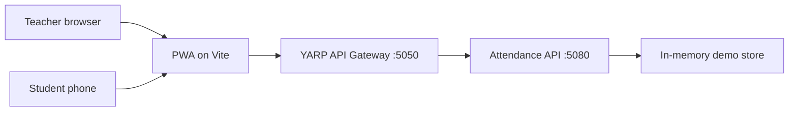

# Rollcall — Attendance Tracker

A responsive attendance tracker for instructors and students. The current MVP demonstrates a teacher starting a class check-in, displaying a rotating QR code, and seeing a student's saved attendance arrive on the teacher dashboard. Students can scan the code with a supported phone browser or type its six-digit fallback.

> **Project status:** MVP for team development. The main teacher and student flows work locally. This is not a production-ready attendance system: demo authentication and process-memory data are used so the team can contribute persistence, identity, security, reporting, and deployment work.

## Architecture and selected stack

- **Web and mobile:** React 19, TypeScript, Vite, responsive installable PWA.
- **API Gateway:** YARP reverse proxy.
- **Backend:** .NET 10 REST API organized as Domain, Application, Infrastructure, and API projects.
- **Storage:** in-memory demo store for now. It resets when the API restarts. Choose and implement persistent storage as a team contribution.
- **Design:** Butter Yellow `#F4D879`, Dark Cocoa `#382820`, and Electric Blue `#315CFF`.



The Figma design reference is [Attendance Tracker Prototype](https://www.figma.com/make/PorOMg0hT9GjNiXGa06Z98/Attendance-Tracker-Prototype?t=HyRmVDl3OcgbmsN9-0).

## Run locally

Requirements: .NET 10 SDK, Node.js 22 or newer, and npm.

Open three terminals at the repository root:

```powershell
# Terminal 1: API
dotnet run --project src/AttendanceTracker.Api --urls http://localhost:5080

# Terminal 2: API Gateway
dotnet run --project src/AttendanceTracker.Gateway --urls http://localhost:5050

# Terminal 3: PWA
cd client
npm install
npm run dev
```

Open `http://localhost:5173`. The gateway's health endpoint is `http://localhost:5050/health`; the API health endpoint is `http://localhost:5080/health`.

### Demo access

Use the role buttons on the sign-in page. Both roles use the local demo password shown on the page (`Demo123!`). The demo teacher is `teacher@attendance.local`; the demo student is `alex@student.attendance.local`.

For a complete check-in demonstration, open a teacher browser and a separate student browser/profile. Start attendance as the teacher, copy the six-digit fallback beneath the teacher QR, then sign in as Alex and use **Scan class QR code** or enter that fallback. The teacher roster updates automatically. Camera scanning requires a secure context and browser support for `BarcodeDetector`; local development on `localhost` is allowed, and the manual code works when camera scanning is unavailable.

The active-session lookup only returns public session details and expiry time; the QR code itself is returned to an authenticated teacher. Attendance submissions use the signed-in student's account, reject stale codes, and prevent duplicate attendance for a student in the same session.

## API routes in the MVP

| Route | Purpose |
| --- | --- |
| `POST /api/auth/login` | Local demo sign-in for teacher or student |
| `GET /api/dashboard` | Teacher course dashboard and current roster |
| `POST /api/sessions` | Teacher starts a session and receives its QR payload |
| `GET /api/sessions/active` | Student-safe active session details (no QR secret) |
| `POST /api/sessions/{id}/refresh-code` | Teacher rotates the short-lived check-in code |
| `POST /api/sessions/{id}/close` | Teacher ends check-in |
| `POST /api/attendance/check-in` | Signed-in student checks in with QR/manual code |
| `GET /api/sessions/{id}/attendance` | Teacher reads the saved session roster |
| `GET /api/me/attendance` | Student reads their attendance records |

The API exposes OpenAPI in development. A polished interactive API reference and request/response examples remain a team task.

## Team contribution backlog

The MVP intentionally leaves substantial work for all four team members. Agree on owners and acceptance criteria together; these are suggested workstreams, not assigned roles.

### Member 1 — Persistence and attendance domain

1. Replace `AttendanceStore` process memory with EF Core repositories and a persistent local database.
2. Add schema migrations and seed data that can be safely re-applied.
3. Model institutions, courses, enrollments, class sessions, and attendance records with appropriate keys and constraints.
4. Implement manual attendance marking and correction with reason, actor, timestamp, and audit history.
5. Add course, enrollment, roster, and attendance CRUD use cases with validation.
6. Write domain and repository tests for duplicates, concurrency, session closure, and invalid status changes.

### Member 2 — Identity, authorization, and QR security

1. Replace the local demo login and hard-coded signing key with the selected institutional identity provider or a proper identity service.
2. Add production token issuance, expiry, renewal, revocation, and logout behavior.
3. Enforce role and course-enrollment authorization on every API route; add per-course teacher ownership rules.
4. Move secrets, key storage, CORS origins, and allowed hosts into environment-based configuration.
5. Strengthen QR check-in against replay, clock skew, code guessing, and excessive requests; document the threat model.
6. Add security tests for expired tokens, unauthorized roles, stale QR codes, cross-course access, and repeated check-ins.

### Member 3 — Containers, deployment, and operations

1. Create multi-stage Dockerfiles for the React PWA, .NET API, and YARP gateway.
2. Add a Docker Compose environment with persistent database storage and service dependencies.
3. Configure container health checks, startup ordering, non-root execution, and graceful shutdown.
4. Externalize ports, database connection strings, gateway destinations, CORS origins, and secrets for each environment.
5. Add a production build and deployment guide for the team's chosen hosting platform.
6. Add CI that builds the client and backend, runs automated tests, and checks container images.

### Member 4 — Product completion and verification

1. Finish attendance history, reports, date filters, exports, and the remaining student schedule/profile journeys.
2. Add instructor roster management, absence/late/excused states, empty states, and correction workflows.
3. Expand end-to-end tests to cover duplicate attempts, code expiry/rotation, closed sessions, permissions, and responsive layouts.
4. Test camera QR scanning on real mobile devices and provide accessible fallbacks when camera permission is denied or unsupported.
5. Review every screen and form for WCAG 2.2 AA contrast, keyboard access, focus order, labels, and screen-reader feedback.
6. Add loading, offline, network error, no-results, and recovery states; finish the dark theme and responsive design tokens.
7. Update OpenAPI examples and the team runbook after the remaining routes and flows are agreed.

## Verification

Build the backend and client with `dotnet build AttendanceTracker.sln`, `cd client && npm install && npm run build`. The browser end-to-end test is `cd client && npm run test:e2e`; it launches the API, gateway, and Vite client and requires Playwright Chromium. Set `DOTNET_EXE` if the SDK executable is not on PATH.

## Current limitations

- Attendance data is stored in process memory and disappears on API restart.
- Demo login accounts, password, and signing key are for local coursework demos only.
- Dashboard metrics, attendance history, and schedule content include sample values.
- No Dockerfiles, Compose setup, production deployment, CI, or real institutional sign-in are included; these are reserved for the team backlog above.
- The current app focuses on QR/manual check-in and a small sample roster. Reports, full course administration, and production-grade authorization remain to be completed.
